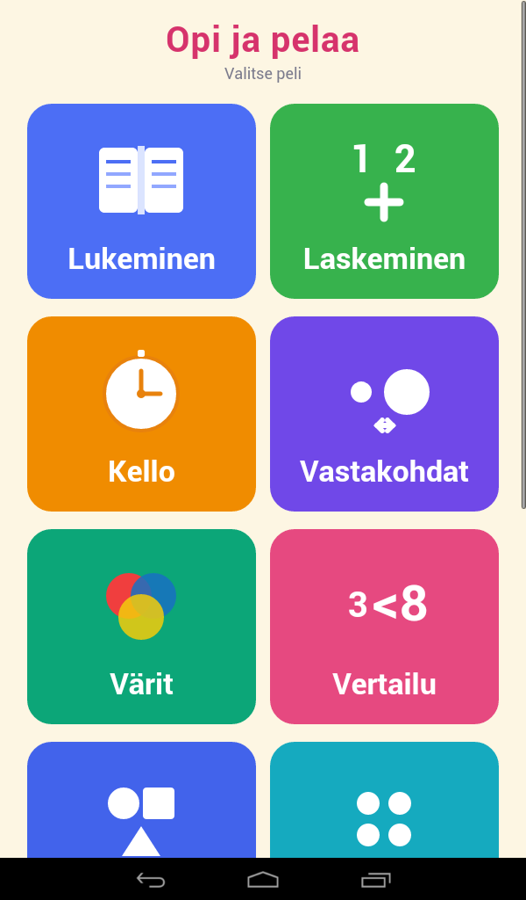
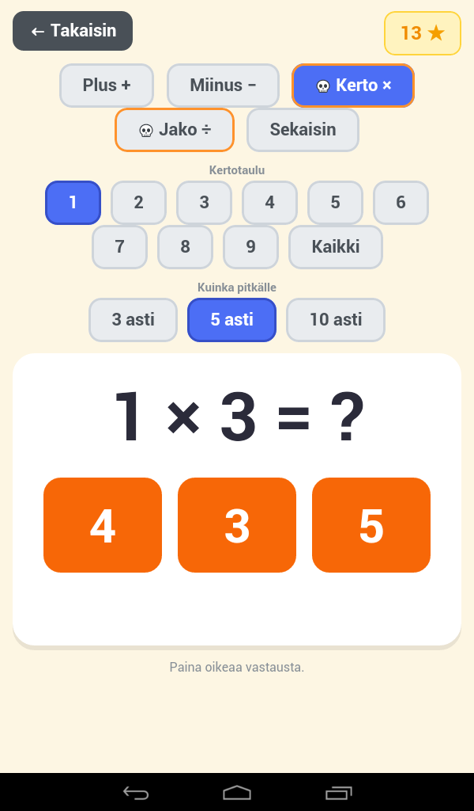
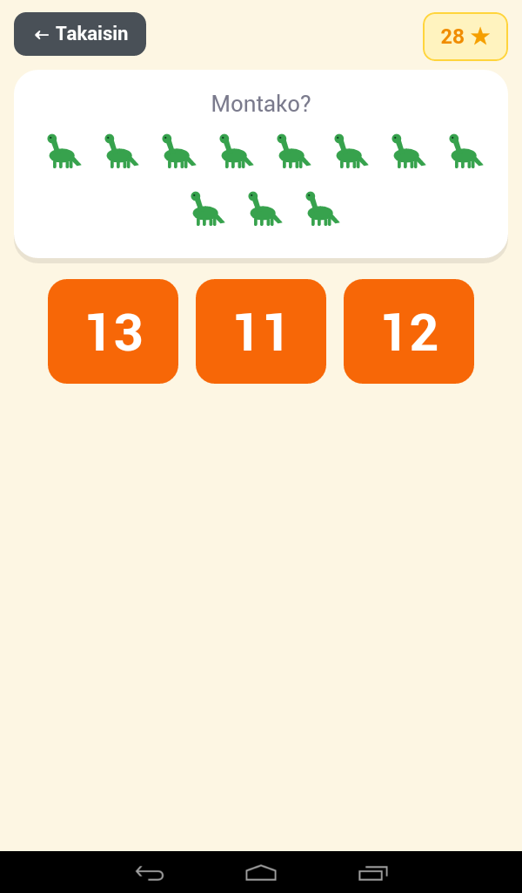
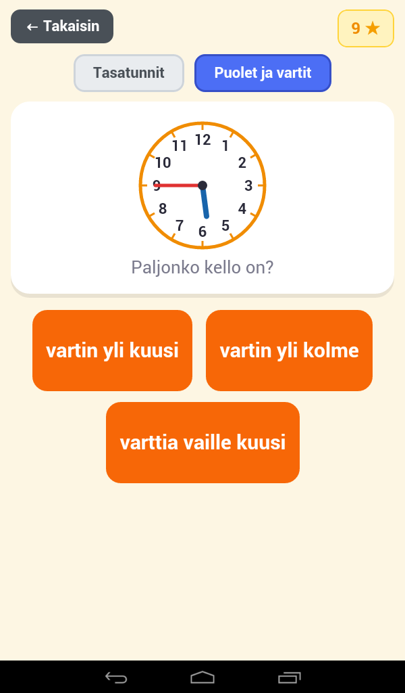

# Opi ja pelaa 🎓

**Offline Finnish learning games for young children** — twelve small, calm activities
(reading, math, telling time, opposites, colours, counting and more) that run entirely
from local files with **no internet, no accounts, no ads, and no tracking**.

It was built to breathe new life into an ancient Android 4.1 tablet as an offline learning
toy for a 5‑year‑old, so every page is deliberately lightweight and works on a very old
browser engine — but it opens just as happily in any modern browser.

**▶ Play online:** <https://gofjhmakit.github.io/opijapelaa/> — works on any phone, tablet or
computer, and can be saved to the home screen as an app (see [Run it](#run-it)).



## The games

All in Finnish, all pure offline:

| Game | What it practises |
|------|-------------------|
| **Lukeminen** | Reading — short sentences, Helppo/Vaikea (easy/hard) difficulty |
| **Laskeminen** | Math — add / subtract (ranges 10–50), plus "hard" **× multiply** and **÷ divide** modes with a selectable times‑table (1–9) |
| **Kello** | Telling time on an analog clock (whole hours, halves, and quarters) |
| **Vastakohdat** | Opposites (50 word pairs) |
| **Värit** | Colours ↔ their Finnish names |
| **Vertailu** | Which number is bigger / smaller |
| **Muodot** | Shapes |
| **Montako?** | Counting — a different picture each round (dinosaurs, ducks, fish, apples, …) |
| **Lukujono** | Number sequences (fill the gap) |
| **Kirjaimet** | Alphabet order (Finnish A–Ö) |
| **Viikonpäivät** | Days of the week |
| **Tavut** | Counting syllables |

Correct answers get a little confetti burst, a short fanfare, and rotating Finnish praise.

<p>
  
  
  
</p>

## Run it

**Online (easiest):** just open <https://gofjhmakit.github.io/opijapelaa/>.

**Save it as an app (iPhone/iPad/Android):** open the link above, then use your browser's
**"Add to Home Screen"** (Safari: Share → Add to Home Screen; Chrome: menu → Install app).
It gets its own icon, opens fullscreen without the browser bars, and keeps working **offline**
after the first visit (a service worker caches everything).

**Fully offline from files:** open `kids-hub/index.html` directly — it works straight from
`file://` with no internet, no server, no build step. This is the version that runs on the
old tablet.

**On an Android tablet:** copy the `kids-hub/` folder onto the device and open `index.html`
in the browser. For a kid‑friendly, chromeless experience there's also a tiny fullscreen
WebView wrapper app in [`app/`](app/) (see below).

## The Android wrapper app (optional)

`app/` is a minimal fullscreen WebView launcher ("Opi ja pelaa") — no address bar, no tabs —
which is about as close to a locked "kids mode" as Android 4.1 allows. Build it with:

```sh
cd app
bash build.sh
```

It uses the Android command‑line tools (`aapt2`, `d8`, `zipalign`, `apksigner`) and a JDK,
and auto‑generates a debug keystore on first run. `minSdk`/`targetSdk` are **16** (Android 4.1).

> Note: `MainActivity.java` loads `file:///storage/sdcard1/kids-hub/index.html` — adjust that
> path (or place `kids-hub/` on the SD card at that location) for your device.

## Developing

All game **data and logic** live in a single source of truth,
[`kids-hub/logic.js`](kids-hub/logic.js) (a UMD module: `window.Hub` in the browser,
`module.exports` in Node). Every game page is a thin wrapper that calls `Hub.<game>.make(...)`,
so the test suite exercises the exact code the tablet runs.

```sh
node tests/run-tests.js      # zero-dependency test suite (~250k assertions)
```

The tests check every generator (correct answer + 3 distinct in‑range options), content
integrity (no duplicate sentences, unique word/colour/shape data, clean divisions that never
make a fraction), and that every page parses with no broken asset references.

### The hosted version (`web/`)

`kids-hub/` is the single source of truth. The online [`web/`](web/) folder is **generated**
from it by [`tools/build_web.py`](tools/build_web.py), which copies the games and layers on the
web‑app bits (manifest, icons, Apple "Add to Home Screen" tags, and an offline service worker).
After editing a game, regenerate and commit it:

```sh
python3 tools/build_web.py      # rebuilds web/ from kids-hub/ + web-src/
```

A GitHub Actions workflow then redeploys `web/` to GitHub Pages. The tablet build
(`kids-hub/` + `app/`) is never affected by any of this.

## Why it looks "early‑2000s"

That's on purpose. Targeting the stock Android 4.1 browser (WebKit ~534) means: no flexbox/grid,
ES5 only, `-webkit-` prefixes, inline SVG instead of emoji (which render as blank boxes), and
plain HTML5 `<audio>`. The result is calm, high‑contrast, and distraction‑free — no flashing,
no dark patterns, no "buy gems" pop‑ups. Just learning.

## License

Licensed under the **[PolyForm Noncommercial License 1.0.0](LICENSE.md)**.

You are free to use, play with, modify, and share this for **any noncommercial purpose**
(personal use, families, schools and other educational institutions, hobby and research).

**Commercial use — including selling it or charging for it — requires a separate license
from the author.** To arrange one, please open an issue on this repository to get in touch.

© 2026 Hermanni Mäkitalo
